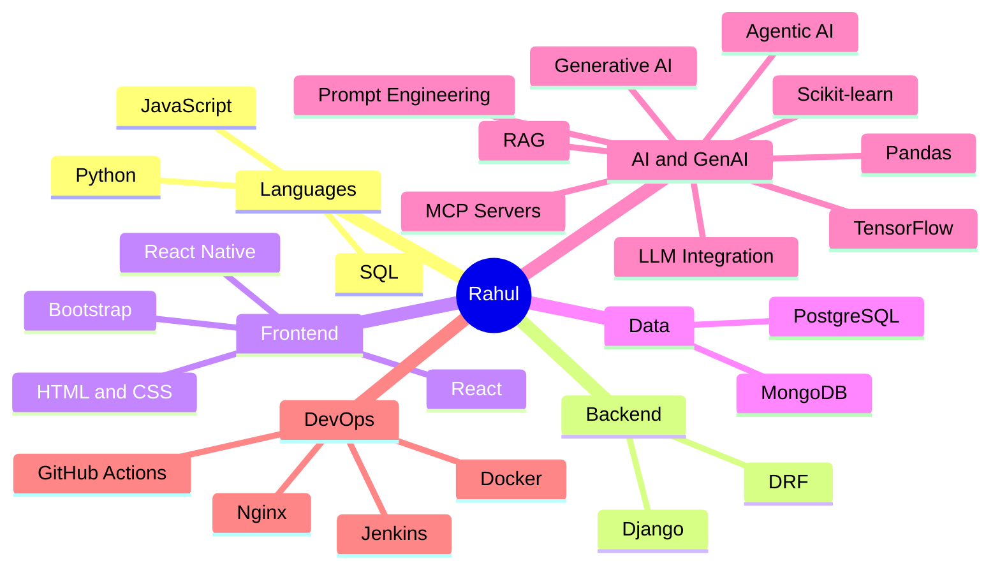

<a id="home"></a>

<div align="center">


<br/>


<br/><br/>

<!-- NAV: in-page anchor links, not browser tabs -->
<a href="#boot"></a>
<a href="#loadout"></a>
<a href="#graph"></a>
<a href="#quests"></a>
<a href="#signal"></a>

<br/><br/>


</div>

<a id="boot"></a>

<div align="center">

## `01` &nbsp;BOOT_SEQUENCE

</div>

```bash
$ whoami
rahul.thakur  # software dev, 6+ years, main-character energy

$ cat focus.txt
Python | backend engineering | Agentic AI | RAG systems

$ cat builds.txt
scalable web apps | REST APIs | automation | AI-powered applications

$ status
> online. shipping. curious.
```

<div align="right"><a href="#home">↑ back to top</a></div>

<a id="loadout"></a>

<div align="center">

## `02` &nbsp;LOADOUT

<sub>everything equipped, nothing for show</sub>

**LANGUAGES**<br/>
 

**BACKEND**<br/>
 

**FRONTEND**<br/>
 

**DATABASES**<br/>


**AI / GENAI**<br/>


**AI FRAMEWORKS**<br/>


**DEVOPS**<br/>


</div>

<div align="right"><a href="#home">↑ back to top</a></div>

<a id="graph"></a>

<div align="center">

## `03` &nbsp;SKILL_GRAPH

</div>



<div align="right"><a href="#home">↑ back to top</a></div>

<a id="quests"></a>

<div align="center">

## `04` &nbsp;QUEST_LOG

</div>

| Quest | Project | Status |
|:---:|:---|:---:|
| `01` | **AI-Based Interview Management System** | `COMPLETED` |
| `02` | **Xtesting Framework** | `COMPLETED` |
| `03` | **URLFilterDB** | `COMPLETED` |
| `04` | **IWF Tool** | `COMPLETED` |

<!-- TODO: add one line + repo link per project, e.g.
| `01` | **AI-Based Interview Management System** - what it does · [Repo](https://github.com/rahult017/REPO_NAME) | `COMPLETED` |
Change the Status value if a project is ongoing. -->

<div align="right"><a href="#home">↑ back to top</a></div>

<a id="signal"></a>

<div align="center">

## `05` &nbsp;SEND_SIGNAL

```bash
$ ping rahul
```

<a href="mailto:rahult016@gmail.com"></a>
<a href="https://github.com/rahult017"></a>


<br/><br/>

**Passionate about Python, backend engineering, Agentic AI, RAG systems, and building intelligent software solutions.**

<br/>


</div>