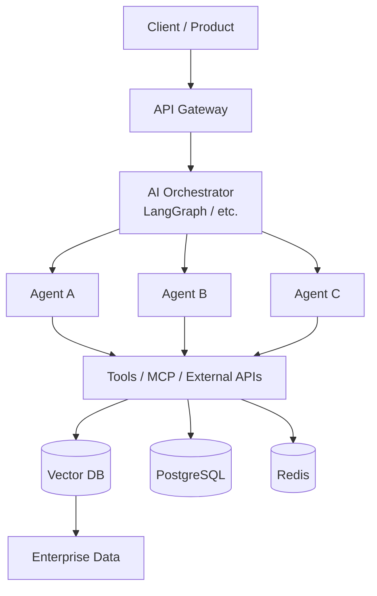

 

  

<!-- NAV: these are in-page anchor links, not browser tabs -->

 

### 🏅 ACHIEVEMENTS UNLOCKED

 

---

# 🔮 SYSTEM.IDENTITY

Yo, I'm **Rahul**, an **AI Systems Architect & Backend Engineer** who has spent **7+ years** turning "it works on my laptop" into "it works at 3am under load, unattended, for 10,000 users."

I'm not here to build a flashy demo that dies the moment real traffic hits it. I engineer the boring-but-critical stuff that makes AI **actually usable in production.**

**CORE_QUESTIONS:**

- 🤔 How does this survive 10,000 concurrent users, not 10?
- 🔁 What happens when an agent's tool call fails mid-flow?
- 💸 How do we keep LLM cost and latency from eating the budget?
- 📊 How do we *actually* evaluate whether the AI is any good?
- 🔒 How do we keep enterprise data locked down?
- 👀 How do we observe and debug what the model is doing in the wild?
- 🏗️ How do we turn a weekend AI experiment into a real platform?

**That's the boss fight I show up for.**

### > "AI is easy to demo. Reliable AI is an engineering discipline."

| Principle | What It Means |
|:---:|:---|
| 🛡️ **Reliability** | Systems that don't randomly implode |
| 📈 **Scalability** | Architecture that grows with demand, not against it |
| 🔍 **Observability** | You always know what the AI is *actually* doing |
| 🔐 **Security** | Enterprise data stays locked down |
| ⚡ **Performance** | Latency and throughput are features, not afterthoughts |
| 💰 **Cost Discipline** | Intelligence with an actual budget |
| 🧩 **Maintainability** | Another engineer can read it without crying |
| 🎯 **Product Impact** | Tech that solves a real problem, not a vibe |

<a href="#home">↑ back to top</a>

---

# 🧪 AI_LAB — What I Build

| Zone | Loot Dropped |
|:---:|:---|
| 🤖 **AI Agents** | Multi-agent workflows, tool calling, orchestration, memory & state |
| 🧠 **LLM Systems** | Production LLM apps, structured outputs, evaluation pipelines |
| 📚 **RAG** | Enterprise knowledge systems, retrieval pipelines, vector search |
| ⚡ **Backend** | High-performance APIs, async systems, distributed services |
| ☁️ **Cloud Native** | Docker, Kubernetes, deployment & scalable infra |
| 🔌 **AI Infrastructure** | MCP servers, AI gateways, observability & platform tooling |
| 🚀 **Microservices** | Go/Python services, event-driven architectures & integrations |

### 🔭 CURRENTLY_GRINDING

 

<a href="#home">↑ back to top</a>

---

# 🎒 TECH_MATRIX

**Languages**

**Backend & Application**

**Infrastructure & Data**

**AI / LLM Engineering**

`LLM Applications` · `Agentic AI` · `Multi-Agent Systems` · `RAG` · `Tool Calling` · `Structured Outputs`
`AI Workflows` · `MCP` · `Prompt Engineering` · `Evaluation` · `AI Observability`

<a href="#home">↑ back to top</a>

---

# 🌐 SYSTEM_ARCHITECTURE

An LLM, in my world, is **one component in a bigger engineered system**, not the whole app.

The hard engineering isn't **"call an LLM."** It's making the whole thing **observable, controllable, secure, and boring-in-a-good-way reliable.**

<a href="#home">↑ back to top</a>

---

# 🏆 BUILD_LOG — Selected Builds

### 🤖 Multi-Agent AI Platform
`FastAPI` · `LangGraph` · `LLMs` · `Redis` · `PostgreSQL`

A platform for orchestrating specialized AI agents, tool execution, state management, and complex workflows.
**Focus:** orchestration · reliability · extensibility · production APIs

### 📚 Enterprise RAG Platform
`LLMs` · `RAG` · `Qdrant` · `PostgreSQL` · `FastAPI`

Knowledge systems built around retrieval quality, contextual answers, and enterprise data boundaries.
**Focus:** retrieval · grounding · document pipelines · evaluation

### ⚡ Production FastAPI Boilerplate
`FastAPI` · `Docker` · `Kubernetes` · `PostgreSQL` · `Redis`

A production-grade backend foundation for launching scalable APIs fast, no duct tape included.
**Focus:** clean architecture · async workloads · containers · deployment

### 🚀 Go Microservices
`Go` · `PostgreSQL` · `Redis` · `REST APIs`

High-performance backend services built around simplicity, concurrency, and operational reliability.
**Focus:** performance · concurrency · distributed systems

<a href="#home">↑ back to top</a>

---

# 📊 LIVE_STATS

<a href="#home">↑ back to top</a>

---

# 🎟️ OPEN_CHANNEL — Let's Build Something Difficult

**Status: 🟢 Open to freelance, contract, and collaboration**

**🏢 Founders / CEOs:** Got an AI idea and need it turned into a *real* product? I architect from the first API call to full production infra.

**👥 Engineering Teams:** Need someone at the intersection of AI, backend, and infra? That's my lane.

**🚀 AI Startups:** Building agents, RAG, or LLM infra? Let's design past the prototype and straight into production.

**🌍 Open Source:** Got a gnarly AI infrastructure problem? I'm in for building useful things with strong engineering bones.

  

**Open to:** freelance builds · AI collaborations · gnarly engineering problems · open source · product opportunities

### Don't just ask an LLM what to build.
### **Build the system around it.** 🔥

